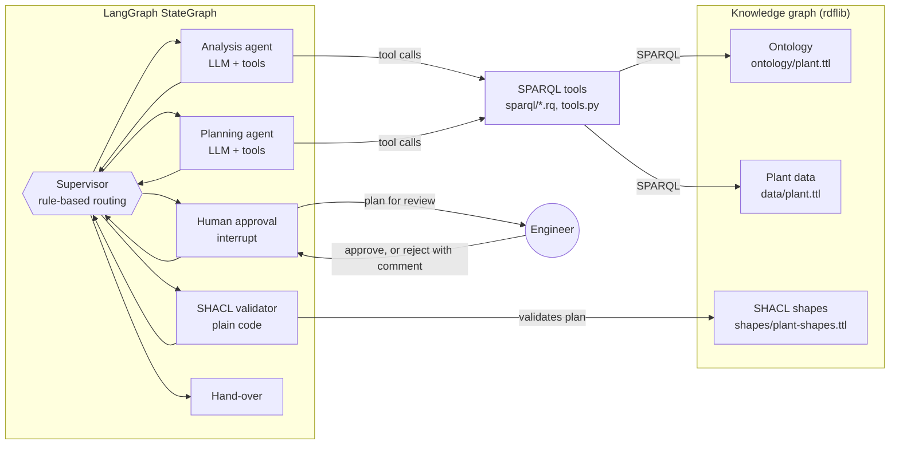

# engineering-agents

A deliberately small multi-agent system in LangGraph: two LLM agents, a rule
check and a human approval work on a plant-engineering task over a shared
ontology.

Built to learn and to explain the ideas behind multi-agent engineering
systems. Every concept has its own chapter in [docs/concepts](docs/concepts/README.md).

## The scenario

> Level transmitter type A is discontinued. Find all installation points in the
> plant and prepare the replacement with type B.

The invented plant has 18 devices. Four of them are level transmitters of
type A. One of these, LT-101, sits on a solvent tank in **Ex zone 1**, and
type B is only approved for zone 2 and non-hazardous areas. A correct
solution has to notice that and pick a different type there.

What a run does:

1. The **analysis agent** queries the knowledge graph and finds the four
   devices with their locations and zones.
2. The **planning agent** proposes a replacement for each; its first plan
   uses type B everywhere.
3. The **SHACL validator** rejects the plan: type B is not approved for zone 1
   at LT-101.
4. The **supervisor** sends the plan back with the violation; the planning
   agent revises LT-101 to type C, which is approved for zone 1.
5. The validator accepts the revised plan.
6. The run **pauses** for a person to approve or reject it (a LangGraph
   interrupt). A rejection goes back to the planning agent with the comment.
7. After approval, the plan is **handed over** as the result.

All plant data, names, manufacturers and certificate numbers are invented.

## Architecture



- The **ontology** defines the vocabulary (device, device type, location, Ex
  zone, approval); the **plant data** uses it. Both are RDF in Turtle, loaded
  into one rdflib graph.
- The **SPARQL tools** are Python functions around named queries. The agents
  see them as tool schemas and ask for them by name; the program runs them.
- The **agents** return structured output (pydantic models), so they pass
  ontology identifiers like `ex:LT-101` to each other, not prose.
- The **supervisor** reads the shared state after every step and decides the
  next one. Every node reports back to it.
- The **validator** checks each plan against the SHACL shapes, on a copy of
  the plant with the proposed types applied.
- The **approval** node pauses the run with `interrupt`; a checkpointer keeps
  the state until the decision comes in with `Command(resume=...)`.

The graph as LangGraph draws it is in [docs/img/graph.mmd](docs/img/graph.mmd)
(`uv run engineering-agents graph`).

## Running

Requires [uv](https://docs.astral.sh/uv/) and Python 3.12.

```console
uv sync
```

### The demo

```console
uv run engineering-agents demo
```

Runs the whole scenario with a heading for each step and asks for the
approval in the terminal (`a` to approve, `r` to reject with a comment). It
uses the OpenAI model when `OPENAI_API_KEY` works, and otherwise a scripted
offline stand-in for the model; the first lines of the output say which.
`--offline` forces the offline model. `--auto-approve` approves without asking
and exists only for tests and non-interactive runs.

In offline mode only the model's answers are scripted; the SPARQL queries,
the SHACL validation and the LangGraph run are real.

### With the OpenAI API

Copy `.env.example` to `.env` and set `OPENAI_API_KEY` (or set it in the
environment); `OPENAI_MODEL` overrides the default small model. `.env` is
ignored by git.

```console
uv run engineering-agents analyse   # the analysis agent alone
uv run engineering-agents plan      # analysis, planning, then a SHACL check of the plan
uv run engineering-agents run       # the whole graph, with the approval in the terminal
```

A full run makes roughly four to eight requests to a small model.

### Without the API

```console
uv run engineering-agents query devices
uv run engineering-agents query installation-points LevelTransmitterA
uv run engineering-agents query type-approvals LevelTransmitterB
uv run engineering-agents query replacement-candidates LT-101
uv run engineering-agents validate
uv run engineering-agents check-replacement --type LevelTransmitterB   # violation in zone 1
uv run engineering-agents check-replacement --type LevelTransmitterC   # conforms
uv run engineering-agents graph
```

### The notebook

[notebooks/walkthrough.ipynb](notebooks/walkthrough.ipynb) walks through the
concepts cell by cell with the offline model: a SPARQL query, the SHACL check
of plan B, the graph diagram, a run up to the interrupt, the paused state, and
the resume with an approval. It is committed with its outputs, so it can be
read without running it.

```console
uv run --group notebook jupyter lab notebooks/walkthrough.ipynb
```

### Checks

The tests replace the model with a scripted stand-in and never call the API.

```console
uv run pytest
uv run ruff check
uv run ruff format --check
```

## Learning path

Read [docs/concepts](docs/concepts/README.md) in order; each chapter uses
this project's files as its examples and ends with exercises.

1. [Ontology, knowledge graph and SPARQL](docs/concepts/01-ontology-and-sparql.md):
   RDF, Turtle, OWL, querying by pattern.
2. [Validation with SHACL](docs/concepts/02-shacl.md): closed-world rules,
   shapes, the validation report, checking a proposed change.
3. [Agents and tool calling](docs/concepts/03-agents-and-tool-calling.md):
   model + tools + loop, tool schemas, structured output.
4. [Orchestration with LangGraph](docs/concepts/04-orchestration-with-langgraph.md):
   state, nodes, edges, the supervisor, the feedback loop.
5. [Human in the loop](docs/concepts/05-human-in-the-loop.md): interrupts,
   checkpointers, threads, approve and reject.

The [concepts index](docs/concepts/README.md) ends with self-check questions
for every chapter.

## Design decisions

- **Deterministic supervisor.** The order of the work is known, so the
  supervisor is a handful of rules on a `status` field. Every route is
  reproducible, free and testable; the reason for each decision is printed.
- **Deterministic validator.** Whether a plan may be handed over is decided by
  SHACL, not by a model: the same plan always gets the same verdict, and the
  report names the device, the zone and the rule. The agents propose, the
  rules dispose.
- **Structured outputs.** Each agent answers through a pydantic schema
  offered to the model as a tool. The next step gets typed data with ontology
  identifiers, not text to parse.
- **Approval before hand-over.** A person sees only plans that already pass
  every written rule, together with the revision history, and decides on what
  the rules cannot cover. A rejection is feedback for the planner, not a dead
  end.
- **Offline model for tests and the demo.** A scripted stand-in plays the
  model, so tests make no API calls and the demo runs without network or key.
  Everything around the model is the real code.
- **One file per concept.** Queries live in `.rq` files, shapes in a `.ttl`
  file, each agent in its own module, so each piece can be read on its own.

## Limitations

- The plant, the ontology and the rules are tiny and invented. The ontology
  is inspired by common plant-engineering terms but follows no standard.
- One validation rule (Ex-zone approval) and two agents. Real replacements
  also depend on process conditions, measuring ranges, mechanical fit,
  procurement and maintenance windows.
- The checkpointer is in memory: a paused run is lost when the process ends.
  A database checkpointer would let a run wait for days.
- The approval is all-or-nothing for the whole plan, and there is one
  reviewer with no roles or audit trail.
- The offline model plays exactly this scenario and ignores the wording of a
  reviewer's comment.
- With a real model, results vary between runs; a planner that checks its own
  draft may skip the revision round entirely.

## Layout

```
ontology/plant.ttl             vocabulary (classes and properties), OWL in Turtle
data/plant.ttl                 the demo plant: devices, types, locations, approvals
shapes/plant-shapes.ttl        SHACL shapes: the rules the plant data must satisfy
src/engineering_agents/
    graph.py                   loads ontology and data into one rdflib graph
    queries.py                 named queries: load, bind parameter, run
    sparql/*.rq                the SPARQL queries, one per file
    validation.py              SHACL validation of the plant or a proposed change
    tools.py                   queries and validation as tools for the agents
    agent.py                   the tool-calling loop and the OpenAI model setup
    analysis.py                analysis agent: finds the affected devices
    planning.py                planning agent: proposes and revises replacements
    orchestration.py           LangGraph graph: state, supervisor, agents, validator, approval
    offline.py                 scripted stand-in for the model, for the offline demo
    cli.py                     command-line interface, including the demo
tests/                         graph, queries, validation, agents, orchestration (offline)
notebooks/walkthrough.ipynb    the concepts cell by cell, with outputs
docs/concepts/                 explanations of the underlying concepts
docs/img/graph.mmd             the orchestration graph as a Mermaid diagram
```

## License

[MIT](LICENSE)
