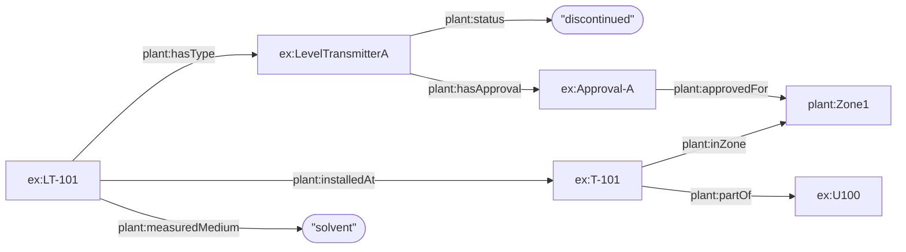
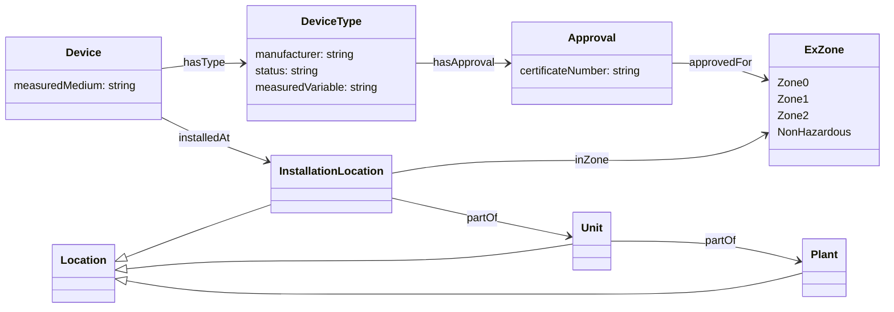

# 01 - Ontology, knowledge graph and SPARQL

The demo starts with a question an engineer might ask:

> Level transmitter type A is discontinued. Where is it installed, and what can
> replace it at each installation point?

Answering it needs connected data. A device points to its type, the type to
its approval, the approval to the zones it allows; the device also points to
its location, and the location to its zone. A spreadsheet holds these as
separate lists. A **knowledge graph** stores them as one network of facts that
can be queried along the links. This chapter explains how this project builds
that graph and how it is queried.

Files used as examples:

| File | Role |
| --- | --- |
| [`ontology/plant.ttl`](../../ontology/plant.ttl) | the vocabulary (ontology) |
| [`data/plant.ttl`](../../data/plant.ttl) | the facts about the demo plant |
| [`src/engineering_agents/sparql/`](../../src/engineering_agents/sparql/) | the named SPARQL queries |
| [`src/engineering_agents/queries.py`](../../src/engineering_agents/queries.py) | loads and runs the queries |

## 1. RDF: everything is a triple

RDF (Resource Description Framework) describes the world as **triples**:

```
subject    predicate        object
ex:LT-101  plant:installedAt ex:T-101
```

"LT-101 is installed at T-101." A triple is the smallest possible fact. A
**graph** is nothing more than a set of triples; triples that share a subject
or object automatically connect into a network.

The parts of a triple:

- **IRIs** name things globally, like URLs. `ex:LT-101` is short for
  `https://example.org/demo-plant#LT-101`. Using IRIs means two data sources
  that talk about the same IRI talk about the same thing, which is what makes
  merging data from different tools possible.
- **Literals** are plain values such as `"solvent"` or a number. They can only
  appear as the object.
- The **predicate** (also an IRI) says how subject and object are related.

Some of the triples around LT-101, drawn as a graph:



The whole demo plant, ontology included, is about 300 triples.

## 2. Turtle: writing triples down

Turtle is a compact text format for RDF. The rules needed to read this
project's files:

```turtle
@prefix plant: <https://example.org/plant#> .        # short name for a namespace
@prefix ex:    <https://example.org/demo-plant#> .
@prefix rdfs:  <http://www.w3.org/2000/01/rdf-schema#> .

ex:LT-101 a plant:Device ;                           # "a" means rdf:type
    rdfs:label "LT-101" ;                            # ";" = same subject, next predicate
    plant:hasType ex:LevelTransmitterA ;
    plant:installedAt ex:T-101 ;
    plant:measuredMedium "solvent" .                 # "." ends the statement

ex:Approval-B a plant:Approval ;
    plant:approvedFor plant:Zone2, plant:NonHazardous .   # "," = same subject and predicate, next object
```

The `ex:Approval-B` block is three triples: one `rdf:type` triple and two
`plant:approvedFor` triples. Lines starting with `#` are comments.

## 3. Ontology vs. data: TBox and ABox

The project keeps two kinds of statements in two files:

- **TBox** (terminology, [`ontology/plant.ttl`](../../ontology/plant.ttl)):
  *what kinds of things exist and how they may relate*. "There are devices.
  A device has a type. A type has an approval."
- **ABox** (assertions, [`data/plant.ttl`](../../data/plant.ttl)): *facts about
  concrete things*. "LT-101 is a device. LT-101 has type A."

Both are ordinary triples, and [`graph.py`](../../src/engineering_agents/graph.py)
simply loads both files into one graph. The split matters for reuse: many
plants (and many tools or agents) can share one vocabulary while each brings
its own data. A shared ontology is the common language that lets independent
components exchange facts without ad-hoc format conversions.

## 4. OWL: classes and properties

OWL (Web Ontology Language) provides the building blocks of the vocabulary.
This project uses only a few of them:

| Construct | Meaning | Example |
| --- | --- | --- |
| `owl:Class` | a kind of thing | `plant:Device`, `plant:ExZone` |
| `rdfs:subClassOf` | every member of A is also a B | `plant:Unit rdfs:subClassOf plant:Location` |
| `owl:ObjectProperty` | a relation between two resources | `plant:installedAt` |
| `owl:DatatypeProperty` | an attribute with a literal value | `plant:status` |
| `rdfs:domain` / `rdfs:range` | what the subject / object of a property is | `plant:hasType` goes from `Device` to `DeviceType` |
| `owl:TransitiveProperty` | if A partOf B and B partOf C, then A partOf C | `plant:partOf` |
| `owl:NamedIndividual` | a fixed, named instance in the vocabulary | `plant:Zone1` |
| `rdfs:label` / `rdfs:comment` | human-readable name and explanation | on every term |

The resulting ontology:



Two design decisions worth noticing:

- **Lifecycle status and approvals belong to the type**, not the device. When
  type A is discontinued, that is one triple, and every device of that type is
  affected through `plant:hasType`.
- **Approvals list every allowed zone explicitly.** A type approved for zone 1
  is in practice also fine in zone 2, but the data says so with an extra
  triple instead of relying on a rule. Explicit data is easier to query and to
  explain.

### OWL describes, it does not check

OWL follows the *open-world assumption*: a missing fact is unknown, not false.
If a device had no `plant:installedAt` triple, OWL would not complain; the
location simply is not known yet. Likewise `rdfs:range` is not a constraint:
from `ex:X plant:hasType ex:Y` a reasoner would *infer* that `ex:Y` is a
`DeviceType`, not reject the triple. And rdflib does no reasoning at all: it
stores exactly the triples in the files. That is why the queries below write
`plant:partOf+` instead of relying on `owl:TransitiveProperty`.

Checking rules such as "a device must only be installed in a zone its type is
approved for" therefore needs a separate, closed-world tool. That is the job
of SHACL, covered in the next chapter.

## 5. SPARQL: querying by pattern

SPARQL is the query language for RDF. A query describes a **pattern of
triples with variables** (`?name`). The engine finds every way to fill in the
variables so that all triples of the pattern exist in the graph. Each such
assignment is one result row.

The smallest example: "which devices are in which zone?"

```sparql
PREFIX plant: <https://example.org/plant#>
PREFIX rdfs:  <http://www.w3.org/2000/01/rdf-schema#>

SELECT ?device ?zone
WHERE {
  ?device plant:installedAt ?loc .
  ?loc plant:inZone ?zoneIri .
  ?zoneIri rdfs:label ?zone .
}
```

Read it as a puzzle: find a `?device` with an `installedAt` link to some
`?loc`, where that same `?loc` has an `inZone` link to some `?zoneIri`, which
has a label `?zone`. Using the same variable twice (`?loc`, `?zoneIri`) is
what **joins** the triples, much like a join on a shared column in SQL.

### Building blocks used in this project

| Feature | What it does | Where |
| --- | --- | --- |
| `;` | repeat the subject | all queries |
| `a` | shorthand for `rdf:type` | [`devices.rq`](../../src/engineering_agents/sparql/devices.rq) |
| `OPTIONAL { ... }` | keep the row even if this part does not match; the variable stays empty | `?medium` in [`devices.rq`](../../src/engineering_agents/sparql/devices.rq) |
| `FILTER (expr)` | drop rows where the expression is false | `?candidate != ?currentType` in [`replacement-candidates.rq`](../../src/engineering_agents/sparql/replacement-candidates.rq) |
| `p1/p2` (property path) | follow `p1`, then `p2`, without naming the node in between | `plant:installedAt/plant:inZone` |
| `p+` (property path) | follow `p` one or more times | `plant:partOf+` (example below) |
| `ORDER BY` | sort the rows | all queries |

**OPTIONAL** matters because real plant data is incomplete. In the demo,
PT-302 and TT-202 have no recorded medium. Without `OPTIONAL`, the pattern
`?device plant:measuredMedium ?medium` would not match for them and both
devices would silently disappear from the result.

**FILTER** works on already-matched rows. This example keeps only devices in
an Ex zone:

```sparql
SELECT ?device ?zone
WHERE {
  ?device plant:installedAt/plant:inZone ?zoneIri .
  ?zoneIri rdfs:label ?zone .
  FILTER (?zoneIri != plant:NonHazardous)
}
```

### Parameters

The named queries take one parameter, for example the device type. Instead of
pasting the value into the query text, [`queries.py`](../../src/engineering_agents/queries.py)
uses rdflib's `initBindings`, which fixes a variable to a value before the
query runs. In [`installation-points.rq`](../../src/engineering_agents/sparql/installation-points.rq)
the variable `?deviceType` is never assigned inside the query; it is bound
from outside to `ex:LevelTransmitterA`. This is the SPARQL equivalent of a
prepared statement in SQL: the query text stays fixed and readable, and a
value can never change its structure.

### Worked example: the Ex-zone conflict

The four named queries answer the opening question step by step:

```console
$ uv run engineering-agents query installation-points LevelTransmitterA
device     location                    unit            zone           medium
---------  --------------------------  --------------  -------------  --------------------
ex:LT-101  T-101 Solvent storage tank  U100 Tank farm  Zone 1         solvent
ex:LT-102  T-102 Process water tank    U100 Tank farm  Non-hazardous  process water
ex:LT-103  T-103 Product tank          U100 Tank farm  Zone 2         intermediate product
ex:LT-301  B-301 Cooling water basin   U300 Utilities  Non-hazardous  cooling water
```

Four installation points. One of them, LT-101, is in zone 1. Is the intended
successor, type B, allowed there?

```console
$ uv run engineering-agents query type-approvals LevelTransmitterB
zone           certificate   status
-------------  ------------  ------
Non-hazardous  DEMO-EX-1002  active
Zone 2         DEMO-EX-1002  active
```

No: type B is approved for zone 2 and non-hazardous areas only. A blanket
"replace A with B" would put an unapproved device into zone 1. Which types
would fit at LT-101?

```console
$ uv run engineering-agents query replacement-candidates LT-101
candidate             label                     manufacturer         zone
--------------------  ------------------------  -------------------  ------
ex:LevelTransmitterC  Level transmitter type C  Sample Sensor Works  Zone 1
```

[`replacement-candidates.rq`](../../src/engineering_agents/sparql/replacement-candidates.rq)
encodes the engineering rule as a pattern: same measured variable as the
current type, status `"active"`, approved for the zone of the installation
location, and a different type. For LT-102 in a non-hazardous area the same
query returns both B and C.

None of this needed custom code per question: the knowledge lives in the
graph, and each question is a pattern over it.

## 6. Try it yourself

List all devices:

```console
uv run engineering-agents query devices
```

Run an ad-hoc query from Python. This one uses the `+` path to find every
device anywhere below the plant, however deep the hierarchy is:

```python
from engineering_agents.graph import load_graph

graph = load_graph()
query = """
PREFIX plant: <https://example.org/plant#>
PREFIX ex:    <https://example.org/demo-plant#>

SELECT ?device
WHERE {
  ?device plant:installedAt/plant:partOf+ ex:DemoPlant .
}
"""
for row in graph.query(query):
    print(row.device)  # 18 devices
```

Exercises:

1. Write a query that counts the devices per unit. Hint: `SELECT ?unit (COUNT(?device) AS ?devices)`
   together with `GROUP BY ?unit`. Expected: 8 in U100, 6 in U200, 4 in U300.
2. Remove the `OPTIONAL` around `plant:measuredMedium` in a copy of
   `devices.rq`. Which devices disappear, and why?
3. Add a fourth level transmitter type to `data/plant.ttl` that is approved
   for zone 1 but discontinued. Does `replacement-candidates LT-101` change?
   Which line of the query decides that?
