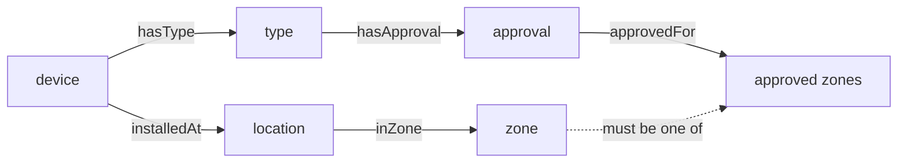
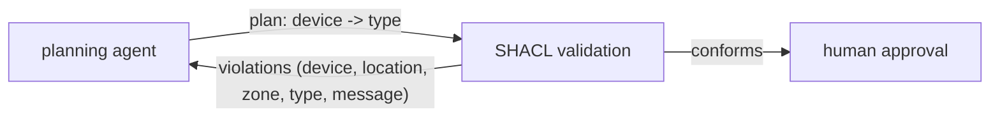

# 02 - Validation with SHACL

Chapter 01 ended with a SPARQL query that *found* the problem: type B is not
approved for zone 1, so it must not replace type A at LT-101. But a query only
answers when someone asks it. Nothing stops a person, a script or an agent
from simply writing "LT-101 has type B" into the graph.

This chapter adds a **rule that must always hold** and a validator that
checks any version of the graph against it. Later, the planning agent's
proposals will be checked the same way, and a violation will send the
proposal back for rework.

Files used as examples:

| File | Role |
| --- | --- |
| [`shapes/plant-shapes.ttl`](../../shapes/plant-shapes.ttl) | the SHACL shapes (the rules) |
| [`src/engineering_agents/validation.py`](../../src/engineering_agents/validation.py) | runs the validator, applies proposed changes to a copy |
| [`tests/test_validation.py`](../../tests/test_validation.py) | the expected results |

## 1. What SHACL is

SHACL (Shapes Constraint Language) is a W3C standard for describing what RDF
data must look like. The rules are called **shapes**, and they are written in
RDF themselves, so a shapes file is just another Turtle file. A **validator**
(here [pySHACL](https://github.com/RDFLib/pySHACL)) takes two graphs, the
*data graph* and the *shapes graph*, and returns a **validation report**: does
the data conform, and if not, which resource broke which rule and why.

A validator only reads. It never adds, removes or repairs triples.

## 2. Why OWL is not enough: open vs. closed world

Chapter 01 already noted that OWL *describes* but does not *check*. The
reason is a different view of missing information:

| | OWL (open world) | SHACL (closed world) |
| --- | --- | --- |
| Purpose | **inference**: derive new facts from known ones | **validation**: check the facts that are there |
| Missing fact | unknown; maybe true somewhere else | absent; a `sh:minCount 1` rule fails |
| `ex:LT-101 plant:hasType ex:T-101` (a location as type) | infers that `ex:T-101` is also a `DeviceType` (from `rdfs:range`) | `sh:class plant:DeviceType` reports a violation |
| Typical question | "What else follows from this?" | "Is this data complete and correct?" |

Both views are useful. The open world suits the web, where no single source
knows everything. Engineering data needs the closed world too: a device
without a known type cannot be ordered, and a device in an unapproved zone
must be flagged, not explained away. So the ontology defines the vocabulary,
and SHACL defines the quality rules on top of it.

## 3. Shapes, targets and constraints

A shape has three parts:

- a **target**: which resources it checks (the *focus nodes*),
- one or more **constraints**: the conditions each focus node must meet,
- optionally a **message** for the report.

The first shape in [`plant-shapes.ttl`](../../shapes/plant-shapes.ttl):

```turtle
shapes:DeviceShape
    a sh:NodeShape ;
    sh:targetClass plant:Device ;          # target: every instance of plant:Device
    sh:property [                          # a property shape ...
        sh:path plant:hasType ;            # ... about the values of plant:hasType
        sh:minCount 1 ;                    # at least one value
        sh:maxCount 1 ;                    # at most one value
        sh:class plant:DeviceType ;        # each value must be a plant:DeviceType
        sh:message "A device must have exactly one device type." ;
    ] ;
    sh:property [
        sh:path plant:installedAt ;
        sh:minCount 1 ;
        sh:maxCount 1 ;
        sh:class plant:InstallationLocation ;
        sh:message "A device must be installed at exactly one installation location." ;
    ] .
```

- A **node shape** (`sh:NodeShape`) is about the focus node itself.
- A **property shape** (`sh:property` with `sh:path`) is about the values
  reached from the focus node along a path. The path can be a single property
  or a SPARQL-like path such as `( plant:installedAt plant:inZone )`.
- `sh:targetClass` is the most common target. Others are `sh:targetNode`
  (one specific resource) and `sh:targetSubjectsOf` / `sh:targetObjectsOf`
  (everything used with a given property).

The constraints used here belong to **SHACL Core**, a fixed set of building
blocks every validator understands:

| Constraint | Checks |
| --- | --- |
| `sh:minCount`, `sh:maxCount` | how many values a property has |
| `sh:class` | each value is an instance of a class |
| `sh:datatype` | each value is a literal of a datatype, e.g. `xsd:string` |
| `sh:in` | each value is one of a fixed list, e.g. `( "active" "discontinued" )` |
| `sh:pattern` | each string value matches a regular expression |

`shapes:InstallationLocationShape` works the same way and requires exactly
one Ex zone per installation location. The engineering rule below depends on
that: a location without a zone would otherwise slip through unchecked.

## 4. SHACL-SPARQL: rules that follow several links

The engineering rule is:

> A device's type must be approved for the Ex zone of the device's
> installation location. Non-hazardous locations need no approval.

Checking it means comparing two paths that start at the same device:



SHACL Core can count and type-check values, but it has no constraint for "the
value at the end of path 1 must be among the values at the end of path 2".
For rules like this, SHACL lets a shape embed a SPARQL query
(**SHACL-SPARQL**, `sh:sparql`):

```turtle
shapes:ExZoneApprovalShape
    a sh:NodeShape ;
    sh:targetClass plant:Device ;
    sh:sparql [
        a sh:SPARQLConstraint ;
        sh:message "{?tag} at {?locationLabel} ({?zoneLabel}): type {?typeLabel} is not approved for {?zoneLabel}." ;
        sh:prefixes shapes: ;
        sh:select """
            SELECT $this ?tag ?locationLabel ?zoneLabel ?typeLabel
            WHERE {
                $this plant:hasType ?type ;
                      plant:installedAt ?location .
                ?location plant:inZone ?zone .
                FILTER (?zone != plant:NonHazardous)
                FILTER NOT EXISTS { ?type plant:hasApproval/plant:approvedFor ?zone }
                # ... labels for the message ...
            }
            """ ;
    ] .
```

How to read it:

- **The query searches for violations.** Every row it returns becomes one
  entry in the report. A device that is fine produces no row.
- **`$this`** is bound to each focus node in turn (every device), just like
  `initBindings` in chapter 01.
- **`FILTER NOT EXISTS { ... }`** keeps a row only if the inner pattern has
  *no* match: here, if no approval of the type lists the zone. This is the
  closed-world step: absence of an approval counts as "not approved".
- **`{?name}`** in `sh:message` is replaced by the value of that variable, so
  the message can name the device, the location, the zone and the type. The
  query selects labels for this; `OPTIONAL` and `COALESCE` fall back to the
  IRI so that a missing label never hides a violation.
- **`sh:prefixes`** points to `sh:declare` entries at the end of the file. The
  query is a string, so the `@prefix` lines of the Turtle file do not apply
  inside it.

The plant as built has one device in zone 1 with a type that is approved
there (LT-101 with type A), so the rule is silent. It only fires when the
data changes.

## 5. The validation report

pySHACL returns the report in three forms: a boolean, an RDF graph and a
text rendering. With LT-101 changed to type B, the report graph looks like
this (shortened; `sh:sourceConstraint` repeats the whole query):

```turtle
[] a sh:ValidationReport ;
    sh:conforms false ;
    sh:result [ a sh:ValidationResult ;
            sh:focusNode ex:LT-101 ;
            sh:resultMessage "LT-101 at T-101 Solvent storage tank (Zone 1): type Level transmitter type B is not approved for Zone 1." ;
            sh:resultSeverity sh:Violation ;
            sh:sourceConstraintComponent sh:SPARQLConstraintComponent ;
            sh:sourceShape shapes:ExZoneApprovalShape ;
            sh:value ex:LT-101 ] .
```

A structural violation, for a device whose type triple was removed:

```turtle
    sh:result [ a sh:ValidationResult ;
            sh:focusNode ex:PT-101 ;
            sh:resultPath plant:hasType ;
            sh:resultMessage "A device must have exactly one device type." ;
            sh:resultSeverity sh:Violation ;
            sh:sourceConstraintComponent sh:MinCountConstraintComponent ;
            sh:sourceShape [ ... ] ] .
```

Because the report is itself RDF, it can be stored, queried or merged like
any other graph. [`validation.py`](../../src/engineering_agents/validation.py)
reads it and returns a plain Python object instead, filling in the device,
location, zone and type of each focus node from the data graph:

```python
ValidationResult(
    conforms=False,
    violations=[
        Violation(
            device="ex:LT-101",
            location="ex:T-101",
            zone="plant:Zone1",
            type="ex:LevelTransmitterB",
            message="LT-101 at T-101 Solvent storage tank (Zone 1): "
            "type Level transmitter type B is not approved for Zone 1.",
        )
    ],
)
```

## 6. Validating a proposal, not the plant

A replacement plan is a mapping "device X gets type Y". `apply_replacements`
copies the graph, replaces the `plant:hasType` triple of each device in the
copy, and `check_replacements` validates the copy. The real plant is never
changed; that only happens after a valid plan has been approved.

```console
$ uv run engineering-agents validate
Conforms: yes

$ uv run engineering-agents check-replacement --type LevelTransmitterB
Proposed change: LevelTransmitterA -> LevelTransmitterB at ex:LT-101, ex:LT-102, ex:LT-103, ex:LT-301

Conforms: no (1 violation)

device     location  zone         type
---------  --------  -----------  --------------------
ex:LT-101  ex:T-101  plant:Zone1  ex:LevelTransmitterB

- LT-101 at T-101 Solvent storage tank (Zone 1): type Level transmitter type B is not approved for Zone 1.

$ uv run engineering-agents check-replacement --type LevelTransmitterC
Proposed change: LevelTransmitterA -> LevelTransmitterC at ex:LT-101, ex:LT-102, ex:LT-103, ex:LT-301

Conforms: yes
```

`check-replacement` finds the devices with the `installation-points` query
from chapter 01 (`--from`, default `LevelTransmitterA`), and exits with status
1 when the plan does not conform. Three of the four type B replacements are
fine; only the zone 1 location is rejected. A plan that uses type B
everywhere except type C at LT-101 conforms too (see the tests).

## 7. How this feeds the planning agent

The SPARQL query in chapter 01 and the shape in this chapter encode the same
engineering knowledge, but they play different roles:

- the **query** helps *find* good options (which types fit LT-101?),
- the **shape** *guards* every result, whoever produced it.

In the multi-agent system the planning agent will propose a replacement plan.
The plan is checked with `check_replacements`; if it does not conform, the
violations go back to the planner as feedback, and it tries again:



The violation message is written so that it can be read by a person and by a
language model alike. The rule lives in the shapes file, not in the agent's
prompt: the agent may forget an instruction, but it cannot get a
non-conforming plan past the validator.

## 8. Try it yourself

Validate a plan of your own from Python:

```python
from engineering_agents.graph import load_graph
from engineering_agents.validation import check_replacements

graph = load_graph()
plan = {"LT-101": "LevelTransmitterC", "LT-102": "LevelTransmitterB"}
print(check_replacements(graph, plan))
```

Exercises:

1. Move LT-103 to zone 1 by changing `ex:T-103 plant:inZone` in a copy of
   `data/plant.ttl` (or with `graph.set(...)` in Python). How many violations
   does `check-replacement --type LevelTransmitterB` report now?
2. Add a property shape that requires `plant:status` on every device type to
   be `"active"` or `"discontinued"` (hint: `sh:in`). Then set one type's
   status to `"obsolete"` and look at the report.
3. Remove the line `FILTER (?zone != plant:NonHazardous)` from the shape.
   Does the plant still conform? Why does the answer depend on how the
   approvals in `data/plant.ttl` are written?
