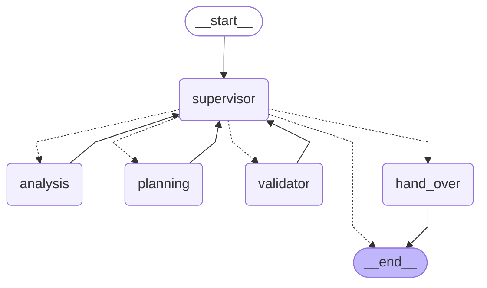

# 04 - Orchestration with LangGraph

Chapter 03 ended with two agents and a validator, but no one in charge.
`engineering-agents plan` runs them in a fixed order, once: analysis, planning,
validation. When the validation fails, the command just prints the violation.
Nobody sends the plan back.

This chapter adds that missing part: a **supervisor** that decides which step
runs next, routes a rejected plan back to the planning agent with the
violations as feedback, stops when the work is done (or when it is not getting
anywhere), and hands over the result. It is built with
[LangGraph](https://langchain-ai.github.io/langgraph/), a library for
programs whose steps form a graph.

Files used as examples:

| File | Role |
| --- | --- |
| [`src/engineering_agents/orchestration.py`](../../src/engineering_agents/orchestration.py) | the shared state, the five nodes, the supervisor's routing, the graph |
| [`src/engineering_agents/cli.py`](../../src/engineering_agents/cli.py) | `run` streams a run node by node; `graph` draws the graph |
| [`tests/test_orchestration.py`](../../tests/test_orchestration.py) | whole runs with the scripted model: one revision, the iteration limit, the validator |
| [`docs/img/graph.mmd`](../img/graph.mmd) | the graph as drawn by LangGraph |

## 1. What orchestration means

A multi-agent system needs more than agents. Something has to decide **who
works on what, in which order, with which input, and when the work is
finished**. That is orchestration. It answers four questions:

- **Control flow:** which step runs next?
- **Data flow:** what does each step get to see, and where does its result go?
- **Feedback:** what happens when a result is not good enough?
- **Termination:** when is the run over, successfully or not?

In chapter 03 a plain Python function answered these questions implicitly:
three calls in a row. That works until the flow needs a loop ("try again with
this feedback") or a stop ("give up after three tries"). Then the flow itself
deserves to be explicit, visible and testable.

## 2. Ways to orchestrate agents

| Pattern | How it works | Fits when |
| --- | --- | --- |
| **Sequential pipeline** | fixed order A, then B, then C; each passes its output on | the steps never repeat or branch (chapter 03's `plan` command) |
| **Supervisor** | one coordinator sees the state after every step and picks the next worker; workers only report back to it | the order depends on results, for example a loop back after a rejection |
| **Swarm / handoffs** | no coordinator; each agent decides itself which agent takes over next and hands the conversation on | open-ended conversations where the right specialist is not known in advance |
| **Blackboard** | agents do not call each other; they read and write a shared store and act when something there concerns them | many independent contributors working on one shared model |

This project uses a **supervisor**: the flow has exactly one loop and one
stop condition, and a single place that decides the route is the easiest to
follow and to test.

The other patterns are not far away, though. The knowledge graph already acts
a little like a **blackboard**: the agents never exchange free text, they
exchange identifiers from the shared ontology (`ex:LT-101`,
`ex:LevelTransmitterC`), and the validator checks every plan against the same
graph. In a larger system, agents could write their results *into* the graph
and react to each other's entries; the ontology would then be the
coordination medium itself, not only the shared vocabulary.

## 3. LangGraph's building blocks

LangGraph models a program as a **state machine**: a shared state, and nodes
that change it, connected by edges.

| Building block | What it is | Here |
| --- | --- | --- |
| **State** | a typed dictionary every node can read | `State` (a `TypedDict`): task, requested type, analysis, plan, violations, planning rounds, status, next route, trace |
| **Node** | a function `state -> partial update` | `supervisor`, `analysis`, `planning`, `validator`, `hand_over` |
| **Edge** | "after node X, run node Y" | every worker goes back to `supervisor` |
| **Conditional edge** | "after node X, call a function to pick the next node" | after `supervisor`, the route it wrote into `state["next"]` |
| **`START` / `END`** | where a run enters and leaves the graph | `START -> supervisor`, `hand_over -> END`, `supervisor -> END` on a stop |
| **Reducer** | how a node's update is merged into the state | `trace` is appended (`operator.add`); every other key is replaced |
| **Context** | per-run inputs that are not state | `Context`: the chat model and the iteration limit |
| **`compile()`** | checks the wiring and turns the builder into a runnable graph | `build_graph()` |
| **`invoke` / `stream`** | run the graph; `stream` yields events while it runs | `invoke` in the tests, `stream` in `engineering-agents run` |

### State and partial updates

A node never builds a whole new state. It returns only the keys it changes:

```python
def validator(state: State) -> dict:
    """Check the plan with SHACL. Plain code: no model, no context."""
    try:
        result = check_replacements(plant_graph(), state["plan"].replacements())
    except ValueError as error:  # e.g. the plan names a type that does not exist
        violations = [Violation(None, None, None, None, f"The plan cannot be applied: {error}.")]
    else:
        violations = result.violations
    if not violations:
        return {"violations": [], "status": "conforms", "trace": [_note("validator", "conforms")]}
    ...
```

LangGraph merges that update into the state. For most keys, merging means
replacing the old value. For `trace` the state declares a **reducer**:

```python
trace: Annotated[list[TraceEntry], operator.add]
```

so the one-entry list a node returns is *appended* to the trace. After a run,
`state["trace"]` is the whole history: which node ran, and what it did or
why it was chosen.

### Wiring and compiling

```python
builder = StateGraph(State, context_schema=Context)
builder.add_node("supervisor", supervisor)
builder.add_node("analysis", analysis)
builder.add_node("planning", planning)
builder.add_node("validator", validator)
builder.add_node("hand_over", hand_over)

builder.add_edge(START, "supervisor")
builder.add_conditional_edges(
    "supervisor",
    lambda state: state["next"],
    ["analysis", "planning", "validator", "hand_over", END],
)
for worker in ("analysis", "planning", "validator"):
    builder.add_edge(worker, "supervisor")
builder.add_edge("hand_over", END)
graph = builder.compile()
```

`compile()` checks that every node is reachable and every edge points to a
known node. The list passed to `add_conditional_edges` names every node the
supervisor may choose; LangGraph needs it to draw the graph (and to reject a
route to an unknown node).

### Context: the model is not part of the graph

The agents need a chat model, but the model is not state (it does not change
during a run) and it should not be baked into the graph (the tests use a
scripted stand-in, the CLI the OpenAI model). LangGraph passes such inputs as
**context**:

```python
graph.invoke(initial_state(), context=Context(model=model, max_planning_rounds=3))
```

A node that needs it declares a `runtime` parameter and reads
`runtime.context.model`. The validator has no such parameter: it cannot reach
a model even by mistake.

## 4. The graph of this project

`uv run engineering-agents graph` asks the compiled graph to draw itself
(`graph.get_graph().draw_mermaid()`) and writes the result to
[`docs/img/graph.mmd`](../img/graph.mmd):



Solid arrows are fixed edges, dotted arrows the supervisor's possible
choices. The shape is a star: every worker reports back to the supervisor, and
only the supervisor decides where to go.

The supervisor routes on one field, `status`, which records what has happened
so far:

| `status` | Set by | Supervisor's decision |
| --- | --- | --- |
| `new` | `initial_state` | -> `analysis` |
| `analysed` | `analysis` | -> `planning` |
| `planned` | `planning` | -> `validator` |
| `rejected` | `validator` | -> `planning` with the violations, or stop with `needs_human` once `max_planning_rounds` plans were rejected |
| `conforms` | `validator` | -> `hand_over` |
| `handed_over` | `hand_over` | (the run is over) |
| `needs_human` | `supervisor` | (the run is over) |

The demo task produces this run (output of `engineering-agents run` with the
scripted model from the tests; tool calls and plan tables shortened):

```
[supervisor] -> analysis: no analysis yet; find the affected devices first
[analysis] found 4 device(s): ex:LT-101 (Zone 1), ex:LT-102 (Non-hazardous), ex:LT-103 (Zone 2), ex:LT-301 (Non-hazardous)
[supervisor] -> planning: the affected devices are known; a plan is needed
[planning] proposed a plan (round 1)
    ex:LT-101  ex:LevelTransmitterB  ...
[supervisor] -> validator: a new plan must be checked against the rules
[validator] does not conform: 1 violation(s)
    - LT-101 at T-101 Solvent storage tank (Zone 1): type Level transmitter type B is not approved for Zone 1.
[supervisor] -> planning: the plan breaks 1 rule(s); send it back with them
[planning] revised the plan (round 2)
    ex:LT-101  ex:LevelTransmitterC  ...
[supervisor] -> validator: a new plan must be checked against the rules
[validator] conforms
[supervisor] -> hand_over: the plan conforms to all rules
[hand_over] plan with 4 entries handed over

Status: handed_over
```

With a real model the planning agent may already avoid type B at LT-101 in
its first round, because its instructions and tools let it check approvals
itself. Then the run skips the revision. The loop is there for the plans that
slip through, and the supervisor does not trust the planner's own check.

## 5. A rule-based or a model-based supervisor?

The supervisor here is a handful of `if` statements. It could also be an
LLM: show it the state and let it pick the next node with a tool call, just
like the agents pick tools.

| | Rule-based supervisor (here) | LLM supervisor |
| --- | --- | --- |
| Same state, same route? | always | usually |
| Cost and latency | none | one model call per step |
| Testable | every route with plain asserts | needs a scripted model or evaluations |
| Handles unforeseen situations | only the ones its rules cover | can improvise, for better or worse |
| Explains itself | the reason is written next to the rule | the model can give a reason, which may not be the real one |

When the order of the work is known, as here, rules win. A model-based
supervisor pays off when the next step really depends on judgement, for
example choosing between many specialists for free-form requests. A common
middle ground is an LLM supervisor with rule-based guards: the model proposes
a route, code rejects impossible ones (planning before analysis, a fourth
round) and falls back to a fixed rule.

## 6. Why the validator is code, not an agent

The validator decides whether a plan may be handed over. That decision must
be **reproducible** (the same plan always gets the same verdict), **exact**
(it either breaks the zone rule or it does not) and **explainable** (a SHACL
report names the device, the zone and the rule). A language model gives none
of these guarantees, and it would be judging output that another language
model wrote.

So the agents propose and the deterministic checks dispose: the LLMs do the
open-ended part (finding the devices from a sentence, choosing and justifying
replacements), and the rules from chapter 02 decide whether the result is
acceptable. The validator node is an ordinary function of the state; it takes
no model, so it cannot use one, and a test asserts that every model call in a
run came from one of the two agents.

## 7. The feedback loop, and how it ends

A rejected plan goes back to the planning agent with the violations. The
planning node passes them to `run_planning` from chapter 03, which writes
them into the task:

```
Your previous plan:
{ ... }

The previous plan was rejected because it breaks these rules:
- LT-101 at T-101 Solvent storage tank (Zone 1): type Level transmitter type B is not approved for Zone 1.
Revise the affected entries.
```

Every loop needs a guaranteed end. This one can end in two ways:

1. **Success:** the validator reports `conforms`; the supervisor routes to
   `hand_over`, which goes to `END`.
2. **Giving up:** each planning run increments `planning_rounds`. When a plan
   is rejected and `planning_rounds` has reached `max_planning_rounds`
   (default 3, `--max-rounds` on the command line), the supervisor sets the
   status `needs_human` and routes to `END`. The last plan and its violations
   stay in the state, so a person can see what went wrong.

Two more limits sit below this one. Each agent's own loop stops after
`max_turns` model calls (chapter 03). And LangGraph counts the steps of a run
and raises an error past a `recursion_limit`, which can be set per run in the
config (`graph.invoke(state, {"recursion_limit": 20}, context=...)`). That is a
crash barrier, not a way to end a run: the supervisor's rule ends it cleanly,
with a status and the state intact. A run of this graph takes at most
`4 + 4 * max_planning_rounds` steps (16 with the default of 3).

## 8. Streaming a run

`graph.invoke(...)` runs to the end and returns the final state. To watch a
run, `engineering-agents run` uses `graph.stream(...)` with three stream modes:

| Mode | Yields | Used for |
| --- | --- | --- |
| `updates` | `{node: partial update}` after each node | the trace lines, the new plan, the violations |
| `custom` | whatever a node passes to `runtime.stream_writer` while it runs | the agents' tool calls, live |
| `values` | the whole state after each step | the last one is the result |

The agent nodes pass `runtime.stream_writer` as the `on_tool_call` callback
from chapter 03, so every tool call shows up the moment it happens, without
any printing inside the graph.

## 9. Where the human approval will go

Right now the supervisor hands a conforming plan over directly. The next
chapter puts a person in between: before `hand_over`, the run pauses
(a LangGraph *interrupt*), shows the plan, and continues only after an
approval. The supervisor's `conforms` branch is where that decision sits.

## 10. Testing the orchestration

`tests/test_orchestration.py` runs the whole graph with the `ScriptedModel`
from chapter 03, so no test calls the API. The SPARQL tools and the SHACL
validator are real. The tests check

- the demo run: plan with type B, rejection at LT-101, revision with the
  violation in the planner's task, conformance, hand-over, in exactly that
  node order;
- the stop: a planner that keeps proposing type B is stopped after
  `max_planning_rounds` with `needs_human` and never reaches `hand_over`;
- the validator: no model call comes from it, and called directly it needs
  nothing but the state;
- the CLI: `run` prints every node's trace line, `graph` writes the diagram.

## 11. Try it yourself

```console
uv run engineering-agents graph                     # draw the graph
uv run engineering-agents run                       # the demo task (calls the OpenAI API)
uv run engineering-agents run --type LevelTransmitterC
uv run engineering-agents run --max-rounds 1
```

`run` needs `OPENAI_API_KEY` like the commands in chapter 03. A run makes
roughly four to eight requests to the small default model.

Exercises:

1. Paste `docs/img/graph.mmd` into a Mermaid viewer. Which arrows would
   disappear if the supervisor could never stop with `needs_human`?
2. Run with `--max-rounds 1`. If the first plan uses type B at LT-101, what
   is the final status, and what does the state still contain for a person to
   look at?
3. The plan only has to satisfy the SHACL shapes. Write down a plan that
   conforms but is still wrong (hint: what if it leaves out a device?). Where
   would you add that check: in the shapes, in the validator node, or in the
   supervisor?
4. Sketch an LLM supervisor: which tool would it get, what would it see, and
   which of the rules in section 4 would you keep as guards?
