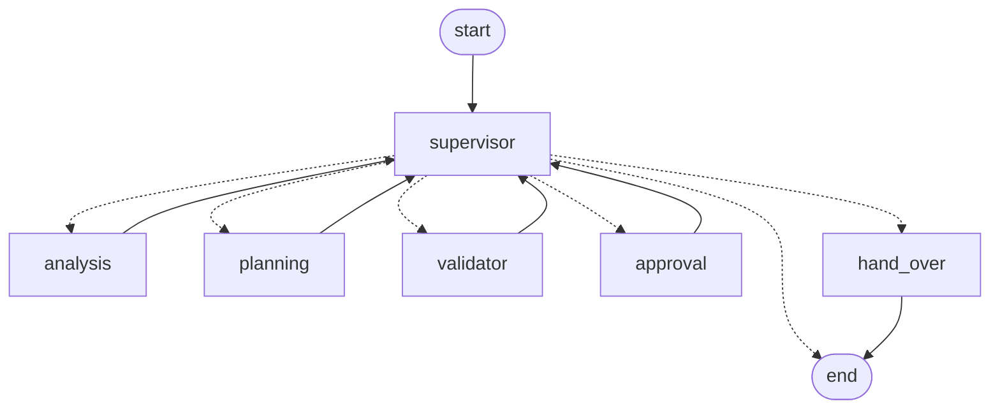

# 05 - Human in the loop: interrupts, checkpointers and threads

After chapter 04 the system runs on its own from the task to the hand-over:
the agents propose, the SHACL validator checks, the supervisor loops until a
plan conforms. That plan is still a proposal written by a language model. In
an engineering setting someone signs off on a change before it becomes an
order, a work package or an entry in the asset register.

This chapter adds that signature. Before the hand-over the run **pauses**,
shows a person the plan, and continues only with their decision: approve, or
reject with a comment that goes back to the planning agent.

Files used as examples:

| File | Role |
| --- | --- |
| [`src/engineering_agents/orchestration.py`](../../src/engineering_agents/orchestration.py) | the `approval` node, `approval_request`, the supervisor's new routes, `memory_checkpointer` |
| [`src/engineering_agents/cli.py`](../../src/engineering_agents/cli.py) | `run_graph`: stream, pause, ask, resume; the `demo` command |
| [`src/engineering_agents/offline.py`](../../src/engineering_agents/offline.py) | the scripted stand-in for the model, so the demo runs without an API key |
| [`tests/test_orchestration.py`](../../tests/test_orchestration.py) | the pause, the approval, the rejection, the demo |
| [`notebooks/walkthrough.ipynb`](../../notebooks/walkthrough.ipynb) | the same steps cell by cell, with the paused state inspected |

## 1. Why a human, and why exactly here

The validator answers one question: does the plan break a rule that is
written down? It cannot answer the questions nobody wrote a rule for: is the
probe length right for this tank, is there a framework contract for type C,
does the shutdown schedule allow the swap next month? Those need someone who
knows the plant.

Where the approval sits matters:

| Position | Effect |
| --- | --- |
| before the analysis | the person approves a task, not a result; nothing to look at yet |
| after planning, before validation | the person reviews plans that may still break rules, and does the validator's job by hand |
| **after validation, before hand-over** (here) | the person only sees plans that already pass every written rule, and decides on what the rules cannot cover |
| after hand-over | too late: the result has left the system |

So the order is: machines check what can be checked mechanically, then a
person decides, then the result leaves the system. The hand-over is the
**point of no return**; the approval belongs immediately before it.

## 2. What an interrupt is

A LangGraph node can call `interrupt(value)`:

```python
def approval(state: State) -> dict:
    decision = interrupt(approval_request(state))
    round_ = f"round {state['planning_rounds']}"
    if decision["approved"]:
        return {"status": "approved", ...}
    comment = decision.get("comment") or "(no comment)"
    return {"status": "changes_requested", "review_comment": comment, ...}
```

The first time the node runs, `interrupt` does not return. It stops the run,
and `value` (here: a readable summary of the plan) is handed to whoever
started the run. The run is now **paused**, not crashed: the state is saved,
and the run can be continued later.

To continue, the caller runs the graph again on the same thread with a
`Command`:

```python
graph.invoke(Command(resume={"approved": True}), config, context=context)
```

LangGraph loads the saved state and runs the paused node **again, from its
first line**. This time `interrupt` does not stop: it returns the resume value
(`{"approved": True}`), and the node finishes normally.

That re-run has a consequence worth remembering: code *before* `interrupt` in
the same node runs twice. Here it only builds the summary text, which is
harmless. A node that wrote to a database or sent an e-mail before its
interrupt would do it twice; such side effects belong after the interrupt or
in a separate node.

## 3. Checkpointers and threads

Pausing needs somewhere to keep the state while nobody is running the graph.
That is the **checkpointer**: after every step, LangGraph saves the whole
state as a *checkpoint*.

```python
graph = build_graph(checkpointer=memory_checkpointer())  # InMemorySaver
config = {"configurable": {"thread_id": "cli-run"}}
graph.invoke(initial_state(), config, context=context)  # runs until the interrupt
graph.get_state(config)  # the paused state
graph.invoke(Command(resume=decision), config, context=context)
```

| Term | Meaning | Here |
| --- | --- | --- |
| **checkpoint** | a saved copy of the state after one step | one per supervisor decision, agent run, validation, ... |
| **checkpointer** | where checkpoints are stored | `InMemorySaver`: a dictionary in the process; gone when the process ends |
| **thread** | one run and all its checkpoints, under a `thread_id` | `"cli-run"` in the CLI, `"walkthrough"` in the notebook |
| **resume** | continue a paused thread with `Command(resume=...)` | the reviewer's decision |

The thread id is how a run is found again. Two runs with different thread ids
are independent: one can wait for approval while the other is being planned.
In production the checkpointer would be a database (LangGraph has SQLite and
Postgres savers), so a run can wait for days, survive a restart, and be
resumed by a different process, for example a web app where the engineer
clicks "approve".

`memory_checkpointer()` is an `InMemorySaver` with one addition: it lists the
project's own classes (`Analysis`, `ReplacementPlan`, `Violation`) as safe to
rebuild from a checkpoint. Checkpoints are serialized data; LangGraph warns
about (and will eventually refuse) classes it has not been told to expect, so
that a tampered checkpoint store cannot make it create arbitrary objects.

`get_state(config)` shows the paused run without changing it:

```python
paused = graph.get_state(config)
paused.next  # ('approval',): the node that will run on resume
paused.values["status"]  # 'conforms'
paused.interrupts[0].value  # the summary the reviewer sees
```

The paused run is not a function waiting somewhere in memory. The process
could exit here; with a persistent checkpointer, a new process could resume
the thread tomorrow.

## 4. What the reviewer sees

`approval_request(state)` builds the summary passed to `interrupt`: every
device with its zone, current and proposed type, the planner's summary, and
the revision history:

```
Approval needed: replacement plan, round 2, 4 device(s)
  ex:LT-101  Zone 1         ex:LevelTransmitterA -> ex:LevelTransmitterC
  ex:LT-102  Non-hazardous  ex:LevelTransmitterA -> ex:LevelTransmitterB
  ex:LT-103  Zone 2         ex:LevelTransmitterA -> ex:LevelTransmitterB
  ex:LT-301  Non-hazardous  ex:LevelTransmitterA -> ex:LevelTransmitterB
Summary: Replace LT-102, LT-103 and LT-301 with type B, and LT-101 in Zone 1 with type C, ...
History:
  round 1: rejected by the SHACL validator
    - LT-101 at T-101 Solvent storage tank (Zone 1): type Level transmitter type B is not approved for Zone 1.
  round 2: conforms to the SHACL rules
```

The history is a second list in the state, `history`, with the same
`operator.add` reducer as the trace. The validator and the approval node each
append one line per verdict. It answers the question a reviewer asks first:
"why is LT-101 different from the others?" A decision is only as good as the
information shown with it; an approval prompt that says "Approve plan? y/n"
invites a reflexive "y".

## 5. Approve and reject

Two new statuses extend the supervisor's table from chapter 04:

| `status` | Set by | Supervisor's decision |
| --- | --- | --- |
| `conforms` | `validator` | -> `approval` (was: -> `hand_over`) |
| `approved` | `approval` | -> `hand_over` |
| `changes_requested` | `approval` | -> `planning` with the comment, or stop with `needs_human` once `max_planning_rounds` is reached |

**Approve:** `{"approved": True}`. The approval node sets `approved`, the
supervisor routes to `hand_over`, the run ends with `handed_over`.

**Reject:** `{"approved": False, "comment": "Order LT-103 with a longer probe."}`.
The approval node stores the comment in `review_comment` and sets
`changes_requested`. The supervisor sends the plan back to the planning agent,
whose task now contains

```
A reviewer rejected an earlier plan with this comment:
Order LT-103 with a longer probe.
Revise the plan so that it takes the comment into account.
```

The revised plan goes through the validator again (a person's comment is no
reason to skip the rules) and then back to the approval. A rejection counts as
a planning round, so the iteration limit from chapter 04 still guarantees an
end: a plan rejected again and again stops with `needs_human`.

The approval node does not route itself. Like every worker it reports back to
the supervisor, which stays the only place where the route is decided. The
graph gained one node and two dotted arrows (see
[`docs/img/graph.mmd`](../img/graph.mmd)):



## 6. The caller's side: pause, ask, resume

`run_graph` in the CLI streams the run, notices the pause, asks, and resumes,
in a loop because a rejection leads to another approval:

```python
graph = build_graph(checkpointer=memory_checkpointer())
config = {"configurable": {"thread_id": "cli-run"}}
graph_input = state
while True:
    for mode, event in graph.stream(graph_input, config, context=context, ...):
        ...                                  # print tool calls and node updates
    paused = graph.get_state(config)
    if not paused.interrupts:
        break                                # the run has ended
    print(paused.interrupts[0].value)
    graph_input = Command(resume=review())   # ask the person, then continue
```

`review` is `ask_in_terminal` (approve, or reject with a comment) or, with
`--auto-approve`, a function that approves without asking. That flag exists
for tests and non-interactive runs only; it prints that it skipped the
question. Without a terminal and without the flag, the run stops at the
approval with an error instead of approving silently.

## 7. The demo and the offline model

`uv run engineering-agents demo` runs the whole scenario with a heading for
each step. It first checks whether `OPENAI_API_KEY` works (one free request
that looks up the model). If not, it says so and uses `OfflineModel`, a
scripted stand-in: it answers each agent with fixed tool calls, chosen from
the conversation (which agent, first plan or revision, tool result back or
not). Its first plan uses type B everywhere, just like a hasty planner; its
revision uses type C at LT-101. The tools, the SPARQL queries, the SHACL
validation and the graph are the real ones; only the model's judgement is
scripted, and it ignores the wording of a reviewer's comment.

This is the same idea as the `ScriptedModel` in the tests, packaged so that
the demo always runs, with or without network and key.

## 8. Testing the pause

`tests/test_orchestration.py` checks, with no API calls:

- the run pauses at `approval` with exactly the expected summary, and
  `get_state` shows `approval` as the next node;
- resuming with an approval reaches `hand_over` without another model call;
- resuming with a rejection runs planning round 3 with the comment in the
  planner's task, validates again and pauses again;
- a rejection at the limit stops with `needs_human`;
- the CLI asks in the terminal (simulated input), refuses to continue without
  a terminal, and `demo` runs end to end with the offline model.

## 9. Try it yourself

```console
uv run engineering-agents demo                  # online if the key works, else offline
uv run engineering-agents demo --offline        # always the scripted model
uv run engineering-agents run                   # needs OPENAI_API_KEY; asks for approval
uv run --group notebook jupyter lab notebooks/walkthrough.ipynb
```

Exercises:

1. In the demo, reject the first plan with a comment. Follow the comment:
   which node stores it, which node reads it, and where does it end up?
2. Reject twice with the default limit of three planning rounds. What is the
   final status, and why does the run not ask a third time?
3. In the notebook, start a second thread before resuming the first. Resume
   them in the opposite order. What does that tell you about where a paused
   run lives?
4. The approval node runs twice per approval (once to pause, once to resume).
   Add a `print` before the `interrupt` call and watch it. What would go wrong
   if that line sent the plan by e-mail instead?
5. Approval is all-or-nothing here. Sketch a resume value that approves some
   devices and rejects others. What would the planning agent and the
   validator need to change?
